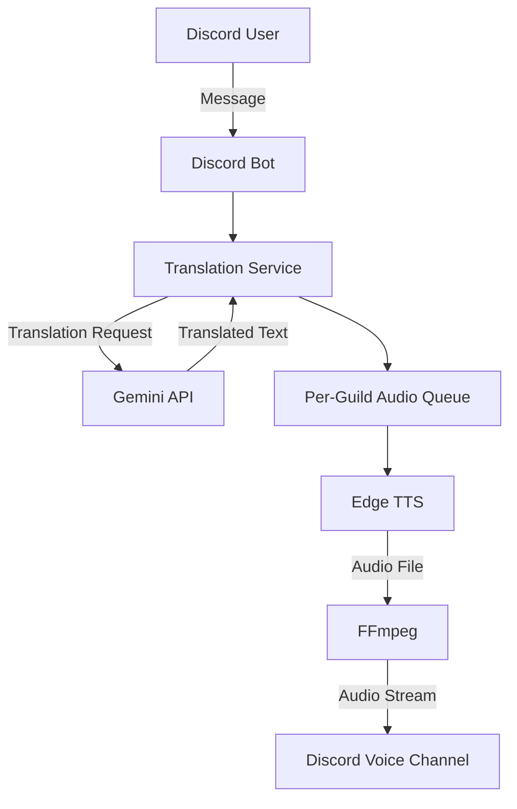

# Discord Translation Bot

Gemini API と Edge TTS を利用した、Discord 向けの音声翻訳 Bot です。

Discord のメッセージを翻訳し、生成した音声をボイスチャンネルで再生します。Docker によるコンテナ化、非同期処理、テスト自動化を取り入れ、保守性と安定した実行を意識して開発しています。

## Architecture



### Processing Flow

1. Bot が Discord のメッセージを受信する
2. Gemini API を利用してメッセージを翻訳する
3. 翻訳結果をサーバーごとの音声キューに登録する
4. Edge TTS で音声を生成する
5. FFmpeg を利用して音声を Discord のボイスチャンネルで再生する

## Features

- Discord メッセージの翻訳
- Gemini API による翻訳処理
- Edge TTS による音声合成
- Discord ボイスチャンネルでの音声再生
- 日本語・英語・韓国語の音声設定
- Guild ごとの設定管理
- 非同期キューによる音声再生の制御

## Technology Stack

| Category               | Technology             |
| ---------------------- | ---------------------- |
| Language               | Python 3.11            |
| Discord Integration    | discord.py             |
| Translation            | Gemini API             |
| Text-to-Speech         | Edge TTS               |
| Audio Processing       | FFmpeg                 |
| Containerization       | Docker, Docker Compose |
| Testing                | pytest, pytest-asyncio |
| Code Quality           | Ruff                   |
| Continuous Integration | GitHub Actions         |

## Design Decisions

### Asynchronous Audio Processing

音声再生処理を非同期キューに分離し、Guild ごとに処理を管理しています。

これにより、音声生成・再生処理をメッセージ受信処理から切り離し、複数の Guild における処理の競合を抑える設計としています。

### Temporary File Management

音声合成によって生成されたファイルを一時ファイルとして管理し、FFmpeg を介して再生します。

複数のメッセージを処理する際のファイル名の衝突を防ぐため、メッセージごとに一意なファイル名を使用しています。

### Error Handling

翻訳、音声合成、音声再生などの処理におけるエラーを個別に扱い、外部サービスの失敗が Bot 全体の停止につながりにくい構成を目指しています。

## Development and CI

GitHub Actions による CI を導入し、コード変更時に以下のチェックを自動実行します。

- pytest による自動テスト
- Ruff による Lint チェック
- Ruff によるフォーマットチェック
- Terraform の format check と app/bootstrap の validate

これにより、変更に伴う不具合やコード品質の問題を早期に検出します。

## Getting Started

### Prerequisites

- Docker Engine
- Docker Compose
- Discord Bot Token
- Gemini API Key

### Runtime dependencies and image reproducibility

Docker build と CI は、Python 3.11 linux/amd64 で確認したruntime依存のversion lock `requirements.lock` を使用します。`requirements.txt` は直接依存の制約、`requirements.lock` はその時点で解決したruntime依存全体のversionを管理します。依存を更新するときは、意図したversion変更としてテストとDocker buildを行った後にlockを更新してください。開発用依存は `requirements-dev.txt` で管理します。

lockを更新するときは、開発用packageを入れていないcleanなPython 3.11 linux/amd64環境に `requirements.txt` をinstallし、`python -m pip freeze --local > requirements.lock` で再生成します。差分を確認し、pytest・Ruff・Docker buildを再実行してください。

Dockerfile の `python:3.11-slim` は可変tagで、apt packageも最新版を取得するため、lockだけではOS/base imageを含む完全なbit-for-bit再現にはなりません。厳密に固定する場合は、運用ルールを決めたうえでbase image digestとapt package versionも固定してください。

### Configuration

```bash
git clone https://github.com/segawa74/discord-translation-bot.git
cd discord-translation-bot

cp .env.example .env
```

`.env` に必要な認証情報を設定します。

```dotenv
DISCORD_TOKEN=your_discord_bot_token
GEMINI_API_KEY=your_gemini_api_key
SHUTDOWN_TIMEOUT_SECONDS=20
```

認証情報を含む `.env` ファイルは Git にコミットしないでください。
`SHUTDOWN_TIMEOUT_SECONDS` は正常終了処理の全体期限（秒）で、既定値は20秒です。Terraform の Fargate 構成では、ECS の停止猶予時間を30秒に設定しています。

### Run

```bash
docker compose up --build
```

停止する場合：

```bash
docker compose down
```

## AWS Deployment (Terraform)

`infra/terraform/` には、state 用 S3 bucket の bootstrap と、ECS Fargate のアプリ構成を分けて配置しています。AWS への適用は利用者の AWS アカウントで行います。

### 構成

- ap-northeast-1 の VPC、2つの public subnet、Internet Gateway、ECS task 用 security group
- ECR repository（immutable image tag、push 時スキャン、直近5イメージを保持）
- ECS Fargate Linux/x86_64 service（初期 desired count は0、起動時は1）
- CloudWatch Logs（保持期間14日、Container Insights 無効）
- task execution role（ECR pull、ログ書込み、指定した SSM parameter の読取りのみ）
- Discord/Gemini 向け SSM SecureString の参照。値そのものは Terraform で作成・更新しません。
- inbound rule は設定せず、HTTPS と Discord voice 用 UDP の outbound のみ許可

NAT Gateway、ALB、RDS、SQS は作成しません。Fargate task は public IPv4 を使って外部サービスと通信します。

### 前提

- Terraform 1.11.4、AWS CLI、Docker
- AWS CLI の認証情報に、記載したリソースを作成・管理する権限が設定済みであること
- state bucket とアプリを同じ AWS region に作成すること

### 1. Terraform state bucket の作成

リポジトリ root から実行し、`state_bucket_name` を世界で一意な名前に変更します。bootstrap の Terraform state は初回作成中は local に保存されるため、state ファイルをリポジトリ外の安全な場所にバックアップしてください。

```bash
cp infra/terraform/bootstrap/terraform.tfvars.example infra/terraform/bootstrap/terraform.tfvars
# terraform.tfvars の state_bucket_name を編集
terraform -chdir=infra/terraform/bootstrap init
terraform -chdir=infra/terraform/bootstrap plan
terraform -chdir=infra/terraform/bootstrap apply
terraform -chdir=infra/terraform/bootstrap output -raw state_bucket_name
```

bucket は versioning、SSE-S3 暗号化、public access block、TLS 必須ポリシーを有効にし、Terraform の `prevent_destroy` を設定します。

### 2. アプリ用 Terraform の初期化

出力された bucket 名を `backend.hcl` に設定します。`terraform.tfvars.example` をコピーし、初回構築では `desired_count = 0`、`image_tag = "bootstrap"` のままにします。`terraform.tfvars` はGit除外対象で、app rootの `desired_count` 既定値も0です。

```bash
cp infra/terraform/app/backend.hcl.example infra/terraform/app/backend.hcl
cp infra/terraform/app/terraform.tfvars.example infra/terraform/app/terraform.tfvars
# backend.hcl の bucket 名、必要に応じて terraform.tfvars の設定を編集
terraform -chdir=infra/terraform/app init -backend-config=backend.hcl
terraform -chdir=infra/terraform/app plan -out=tfplan -var='desired_count=0'
terraform -chdir=infra/terraform/app show -no-color tfplan
terraform -chdir=infra/terraform/app apply tfplan
```

S3 backend は Terraform 1.11 のS3 native state locking（`use_lockfile`）を使います。`tfplan`、backend、tfvarsはGitに追加せず、planは適用後に削除してください。Terraform stateにはアプリ設定、IAM policy、parameter ARN等が記録されるため、state bucketへのアクセスも制限してください。

初回構築では0台にするための `-var='desired_count=0'` を明示します。初回構築後の**通常運用では、ローカルの `terraform.tfvars` に稼働数1と現在のimage tagを保持**してください。ファイルがない場合は既定値0となり、plan/applyでBotが停止します。通常のplanでは `desired_count` とtask definitionのimage tagが意図した値か確認してからapplyします。`ignore_changes`は設定せず、稼働数もTerraformで管理します。

### 3. Secret の登録と初回起動

AWS Systems Manager Parameter Storeに次の名前で**Standard SecureString** parameterを作成し、値をAWS側で登録します。AWS Consoleでは名前と型を確認し、復号値を表示しないでください。Secret値をTerraform variable、`.tfvars`、CLI引数、コマンド履歴、ログ、Git、planに含めないでください。Terraform task definitionとplanに入るのはparameter ARNのみです。

- `/discord-translation-bot/prod/DISCORD_TOKEN`
- `/discord-translation-bot/prod/GEMINI_API_KEY`

AWS-managed SSM keyを使う場合、追加のKMS設定は不要です。customer-managed KMS keyを使う場合は、そのARNを`secret_kms_key_arn`に設定してください。ECS task execution roleとKMS key policyの両方で復号を許可する必要があります。

parameter名・型を確認したら、リポジトリrootからimageをbuild/pushします。タグをcommitに対応させるため、image build元のGit worktreeに未コミットのソース変更がないことを確認します。

```bash
git status --short
AWS_REGION=ap-northeast-1
ECR_REPOSITORY_URL=$(terraform -chdir=infra/terraform/app output -raw ecr_repository_url)
ECR_REGISTRY="${ECR_REPOSITORY_URL%%/*}"
IMAGE_TAG="$(git rev-parse --short=12 HEAD)-$(date -u +%Y%m%d%H%M%S)"

aws ecr get-login-password --region "$AWS_REGION" \
  | docker login --username AWS --password-stdin "$ECR_REGISTRY"
docker build --platform linux/amd64 -t "$ECR_REPOSITORY_URL:$IMAGE_TAG" .
docker push "$ECR_REPOSITORY_URL:$IMAGE_TAG"
```

push後、ECR上に同じtagがあることを確認します。最初はtaskを起動せずに実task definitionへ更新し、planでimage tagが正しいことを確認します。

```bash
# terraform.tfvars: desired_count = 0、image_tag = "<pushしたtag>"
terraform -chdir=infra/terraform/app plan -out=tfplan
terraform -chdir=infra/terraform/app show -no-color tfplan
terraform -chdir=infra/terraform/app apply tfplan
```

その後、`terraform.tfvars` の `desired_count` を `1` に変更し、planに `desired_count: 0 -> 1` と正しいimage tagが表示されることを確認してから適用します。

```bash
terraform -chdir=infra/terraform/app plan -out=tfplan
terraform -chdir=infra/terraform/app show -no-color tfplan
terraform -chdir=infra/terraform/app apply tfplan
```

通常運用・image更新でも、`terraform.tfvars` の `desired_count = 1` と意図した `image_tag` を保持し、plan上の値を確認してからapplyしてください。更新時は旧taskを停止してから新taskを起動するためBotの一時停止が発生しますが、同時に2 taskは動作しません。

#### 初回起動失敗時の確認・復旧

初回起動時には正常稼働した旧revisionがありません。deployment circuit breakerは失敗を検出しても、正常な稼働revisionへのrollbackを保証しません。特に初回構築ではrollbackだけに依存しないでください。

1. ECS Consoleで `ECS > Clusters > <cluster> > Services > <service>` を開き、**Events / Deployments / Tasks**からdeployment状態、taskのstopped reason、image pullやSSM取得エラーを確認します。cluster/service名は `terraform -chdir=infra/terraform/app output` で確認できます。
2. CloudWatch Logsの `terraform -chdir=infra/terraform/app output -raw log_group_name` が示すlog groupと最新streamを確認します。コンテナが起動する前の失敗は、ECS service eventsやtask stopped reasonに出る場合があります。
3. Systems Manager Parameter Storeで2つのparameterの**名前と型がStandard SecureStringであることだけ**を確認します。復号値は表示・出力しません。ECR Consoleではtask definitionが参照するimage tagの存在とlinux/amd64 imageを確認します。
4. 失敗が続く場合は `terraform.tfvars` を `desired_count = 0` にし、planで0台への変更を確認してapplyして停止します。parameter名・型・KMS key policyまたはimage tag/platformを修正後、image tagを0台のまま登録し、最後に1台へscaleします。

#### Secret更新時

SSM SecureStringの値を更新しても、実行中taskの環境変数は変わりません。値の更新後にECS serviceで新deploymentを開始してください。たとえば次のコマンドはtaskを再起動し、起動時にSSMから最新値を読み直します。desired countは変更しません。

```bash
aws ecs update-service \
  --cluster "$(terraform -chdir=infra/terraform/app output -raw ecs_cluster_name)" \
  --service "$(terraform -chdir=infra/terraform/app output -raw ecs_service_name)" \
  --force-new-deployment \
  --region ap-northeast-1
```

実行後は上記のECS Events/DeploymentsとCloudWatch Logsで安定稼働を確認します。Secret値をコマンド引数やTerraformへ渡さないでください。

### 停止・削除

- Botだけ停止する場合は `desired_count = 0` にしてplanを確認し、app stackをapplyします。ECR、VPC、ログ、state bucketは残ります。
- app stack の削除には `terraform -chdir=infra/terraform/app destroy` を使います。ECR repository に image が残っている場合、削除前に image を削除してください。
- SSM parameterはTerraform管理外なのでapp destroy後も残ります。不要になったSecretはAWS側で削除またはrotationし、必要なCloudWatch Logsはdestroy前に保存してください。
- state bucket は `prevent_destroy` で保護されます。state bucket は app stack の削除後も維持し、必要な state backup と移行を済ませるまで削除しないでください。

### 月額費用の概算

東京リージョン、Fargate Linux/x86、1 task を730時間稼働、ログ取り込み1GB/月、5GB/月の internet egress とした単純試算です。無料枠を差し引かず、ECRの保存量は1.5GBのimageを5世代として見積もっています。

| 項目 | 仮定 | 概算/月 |
| --- | --- | ---: |
| Fargate | 0.25 vCPU × 730時間 + 1 GiB × 730時間 | $13.26 |
| Public IPv4 | 1 IP × 730時間 | $3.65 |
| CloudWatch Logs | 1GB ingest + 1GB-month storage | $0.79 |
| ECR | 7.5GB-month × 仮単価 $0.10/GB-month | $0.75 |
| Internet egress | 5GB × 仮単価 $0.114/GB | $0.57 |
| Terraform state S3 | 1GB-month × 仮単価 $0.025/GB-month | $0.03 |
| **合計** |  | **約 $19.05/月** |

Fargate単価は0.25 vCPU-hour `$0.05056`、memory GB-hour `$0.00553`、Public IPv4はIP-hour `$0.005`、CloudWatch Logsはingest `$0.76/GB`・storage `$0.033/GB-month`で計算しています。ECR pricing pageの`$0.10/GB-month`は例示価格で東京リージョンの適用単価を確定できず、S3 Standardの`$0.025/GB-month`とinternet egressの`$0.114/GB`も今回参照できた公開ページでは東京の該当表を確認できないため、いずれも**仮単価**です。Calculatorで適用前に確認してください。

無料枠・allowanceは差し引いていません。AWSのdata transfer pricing pageにある月100GBのaggregate allowance、CloudWatch/ECRのfree tierも計算に含めていません。ECRから同一リージョンのFargateへのimage転送はAWS pricing page上で無料です。ECRの実費は圧縮後のunique layer容量（tag間のlayer共有を含む）で決まり、7.5GB-monthは単純な上限寄りの仮定です。14日保持でCloudWatchに1GB/月を均等に取り込む場合、1GB-month storageも保守的な仮定です。

Standard Parameter Store parameterの保存料は追加されませんが、KMS API requestは別途です。公開KMS価格の対称request単価 `$0.03/10,000 requests` を無料枠なしで計算すると、parameter 2件のtask起動時decryptは約`$0.000006/起動`です。新たなcustomer-managed KMS keyを作る場合はkey storage `$1/key-month`とrequest/rotation料金も加わります（既存keyを使う場合は新規keyの月額増分なし）。これらの費用は合計に含めていません。`desired_count=0`にするとFargate taskとtaskのPublic IPv4料金は止まりますが、ECR image、CloudWatchに残るlog、versioningされたS3 state objectの料金は残ります。

Voice利用量による実際のinternet egress、ログ量、SSM/KMS request、税、Gemini等の外部API料金も別途です。

料金の確認先：[AWS Fargate](https://aws.amazon.com/fargate/pricing/)、[VPC](https://aws.amazon.com/vpc/pricing/)、[CloudWatch](https://aws.amazon.com/cloudwatch/pricing/)、[ECR](https://aws.amazon.com/ecr/pricing/)、[S3](https://aws.amazon.com/s3/pricing/)、[Internet data transfer](https://aws.amazon.com/ec2/pricing/on-demand/#Data_Transfer)、[Systems Manager](https://aws.amazon.com/systems-manager/pricing/)、[KMS](https://aws.amazon.com/kms/pricing/)。

## Testing and Code Quality

開発用依存関係をインストールします。

```bash
pip install -r requirements.lock -r requirements-dev.txt
```

テスト：

```bash
pytest
```

Lint：

```bash
ruff check .
```

フォーマットチェック：

```bash
ruff format --check .
```

## Roadmap

- [ ] AWS 環境へのデプロイと運用手順の整備
- [x] Terraform によるインフラストラクチャのコード管理
- [ ] ログ・監視・障害調査の仕組みの強化
- [ ] 設定情報の永続化
- [ ] 翻訳時の文脈保持
- [ ] 音声キューのキャンセル・優先度制御
- [ ] 結合テストの拡充

## Limitations

- 翻訳と音声合成は外部サービスに依存します。
- API の利用制限やネットワーク障害により、処理が失敗する場合があります。
- Terraform のAWS構成は追加済みですが、AWS環境への apply・実デプロイ・クラウド上の監視は未実施です。

## License

ライセンスは未設定です。再利用・再配布の条件については、ライセンスファイルの追加後に明記します。
