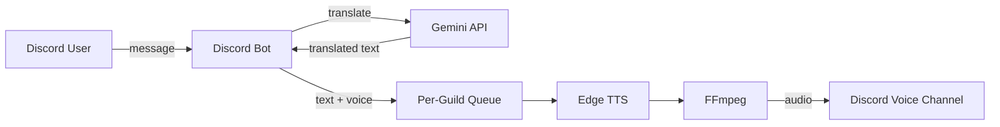

# Discord Translation Bot

Discordのボイスチャンネルで、テキストメッセージを翻訳して読み上げるBotです。言語の異なるフレンドとマルチプレイゲームをしながら会話するために開発しました。AWS ECS Fargate上で、Discord接続・翻訳・音声再生まで動作確認済みです。

## Features

- `!join` でユーザーのVCに接続（デフォルト: 日本語）
- `!ja` / `!en` / `!ko` で翻訳先を切替
- 接続したテキストチャンネルのメッセージをGemini APIで翻訳し、チャンネルに投稿
- Edge TTSで音声合成し、FFmpeg経由でVCに再生
- Guildごとの非同期音声キュー
- `!bye` で切断
- SIGTERM時にキューを期限内に処理するgraceful shutdown

## Architecture



## Tech Stack

| Area | Stack |
| --- | --- |
| Language | Python 3.15 |
| Discord | discord.py |
| Translation | Gemini API (`gemini-3.1-flash-lite`) |
| TTS / Audio | Edge TTS, FFmpeg |
| Runtime | Docker, Docker Compose |
| Infrastructure | Terraform, ECS Fargate, ECR, CloudWatch Logs, SSM Parameter Store |
| Testing / CI | pytest, pytest-asyncio, Ruff, GitHub Actions |

## Design Notes

- **Per-guild async queue**: 翻訳・音声合成・再生を分離し、Guildごとに独立して処理。
- **Temporary files**: TTS音声は一意な一時ファイルに保存し、再生後に削除。
- **Graceful shutdown**: SIGTERMで新規受付を停止し、`SHUTDOWN_TIMEOUT_SECONDS`以内にキューを処理。
- **Error isolation**: 翻訳・TTS・再生の失敗を個別に処理し、Bot全体の停止を防ぐ。

## Quick Start

```bash
git clone https://github.com/segawa74/discord-translation-bot.git
cd discord-translation-bot
cp .env.example .env
# .env に DISCORD_TOKEN と GEMINI_API_KEY を設定
docker compose up --build
```

停止は `docker compose down`。

## AWS Deployment

`infra/terraform/` で管理。state用S3バケット（bootstrap）とアプリ用スタックを分離しています。

- ECS Fargate + ECR + CloudWatch Logs
- 認証情報はSSM Parameter StoreのSecureStringを参照。Terraformは値を保持しない
- インバウンドなし。EgressはDiscord Voice用のTCP 443/2053/2083/2087/2096/8443とUDP 1024-65535のみ
- 初回は`desired_count=0`で構築し、イメージとSSMパラメータ準備後に1へ
- イメージは`linux/amd64`でECRへpush

導入手順は `infra/terraform/bootstrap` と `infra/terraform/app` の `.example` を参照してください。

## Development

```bash
pip install -r requirements.lock -r requirements-dev.txt
pytest
ruff check .
ruff format --check .
```

CIではpytest、Ruffのlint/format check、Terraformのfmt/validateを実行します。

## Limitations

- 翻訳・音声合成・Discord接続は外部サービスに依存します。
- 長期運用向けの監視・アラートは未整備です。
- ライセンスは未設定です。
