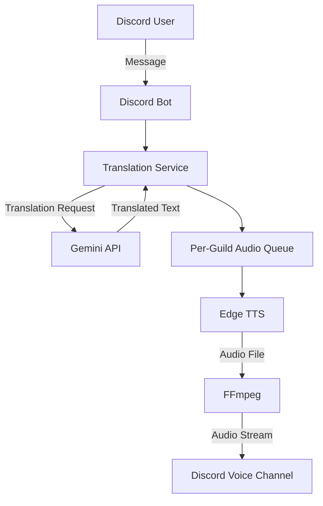

# Discord Translation Bot

Gemini API と Edge TTS を利用した、Discord 向けの音声翻訳 Bot です。

Discord のメッセージを翻訳し、生成した音声をボイスチャンネルで再生します。Docker によるコンテナ化、非同期処理、テスト自動化を取り入れ、保守性と安定した実行を意識して開発しています。

## Architecture



### Processing Flow

1. Bot が Discord のメッセージを受信する
2. Gemini API を利用してメッセージを翻訳する
3. 翻訳結果をサーバーごとの音声キューに登録する
4. Edge TTS で音声を生成する
5. FFmpeg を利用して音声を Discord のボイスチャンネルで再生する

## Features

- Discord メッセージの翻訳
- Gemini API による翻訳処理
- Edge TTS による音声合成
- Discord ボイスチャンネルでの音声再生
- 日本語・英語・韓国語の音声設定
- Guild ごとの設定管理
- 非同期キューによる音声再生の制御

## Technology Stack

| Category               | Technology             |
| ---------------------- | ---------------------- |
| Language               | Python 3.11            |
| Discord Integration    | discord.py             |
| Translation            | Gemini API             |
| Text-to-Speech         | Edge TTS               |
| Audio Processing       | FFmpeg                 |
| Containerization       | Docker, Docker Compose |
| Testing                | pytest, pytest-asyncio |
| Code Quality           | Ruff                   |
| Continuous Integration | GitHub Actions         |

## Design Decisions

### Asynchronous Audio Processing

音声再生処理を非同期キューに分離し、Guild ごとに処理を管理しています。

これにより、音声生成・再生処理をメッセージ受信処理から切り離し、複数の Guild における処理の競合を抑える設計としています。

### Temporary File Management

音声合成によって生成されたファイルを一時ファイルとして管理し、FFmpeg を介して再生します。

複数のメッセージを処理する際のファイル名の衝突を防ぐため、メッセージごとに一意なファイル名を使用しています。

### Error Handling

翻訳、音声合成、音声再生などの処理におけるエラーを個別に扱い、外部サービスの失敗が Bot 全体の停止につながりにくい構成を目指しています。

## Development and CI

GitHub Actions による CI を導入し、コード変更時に以下のチェックを自動実行します。

- pytest による自動テスト
- Ruff による Lint チェック
- Ruff によるフォーマットチェック

これにより、変更に伴う不具合やコード品質の問題を早期に検出します。

## Getting Started

### Prerequisites

- Docker Engine
- Docker Compose
- Discord Bot Token
- Gemini API Key

### Configuration

```bash
git clone https://github.com/segawa74/discord-translation-bot.git
cd discord-translation-bot

cp .env.example .env
```

`.env` に必要な認証情報を設定します。

```dotenv
DISCORD_TOKEN=your_discord_bot_token
GEMINI_API_KEY=your_gemini_api_key
```

認証情報を含む `.env` ファイルは Git にコミットしないでください。

### Run

```bash
docker compose up --build
```

停止する場合：

```bash
docker compose down
```

## Testing and Code Quality

開発用依存関係をインストールします。

```bash
pip install -r requirements-dev.txt
```

テスト：

```bash
pytest
```

Lint：

```bash
ruff check .
```

フォーマットチェック：

```bash
ruff format --check .
```

## Roadmap

- [ ] AWS 環境へのデプロイと運用手順の整備
- [ ] Terraform によるインフラストラクチャのコード管理
- [ ] ログ・監視・障害調査の仕組みの強化
- [ ] 設定情報の永続化
- [ ] 翻訳時の文脈保持
- [ ] 音声キューのキャンセル・優先度制御
- [ ] 結合テストの拡充

## Limitations

- 翻訳と音声合成は外部サービスに依存します。
- API の利用制限やネットワーク障害により、処理が失敗する場合があります。
- AWS へのデプロイおよびクラウド上での監視は、今後の改善項目です。

## License

ライセンスは未設定です。再利用・再配布の条件については、ライセンスファイルの追加後に明記します。
