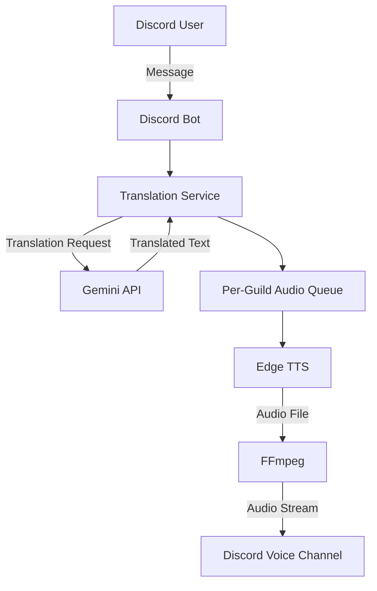

# Discord Translation Bot

Gemini API と Edge TTS を利用した、Discord 向けの音声翻訳 Bot です。

Discord のメッセージを翻訳し、生成した音声をボイスチャンネルで再生します。Docker によるコンテナ化、非同期処理、テスト自動化を取り入れ、保守性と安定した実行を意識して開発しています。

## Architecture



### Processing Flow

1. Bot が Discord のメッセージを受信する
2. Gemini API を利用してメッセージを翻訳する
3. 翻訳結果をサーバーごとの音声キューに登録する
4. Edge TTS で音声を生成する
5. FFmpeg を利用して音声を Discord のボイスチャンネルで再生する

## Features

- Discord メッセージの翻訳
- Gemini API による翻訳処理
- Edge TTS による音声合成
- Discord ボイスチャンネルでの音声再生
- 日本語・英語・韓国語の音声設定
- Guild ごとの設定管理
- 非同期キューによる音声再生の制御

## Technology Stack

| Category               | Technology             |
| ---------------------- | ---------------------- |
| Language               | Python 3.11            |
| Discord Integration    | discord.py             |
| Translation            | Gemini API             |
| Text-to-Speech         | Edge TTS               |
| Audio Processing       | FFmpeg                 |
| Containerization       | Docker, Docker Compose |
| Testing                | pytest, pytest-asyncio |
| Code Quality           | Ruff                   |
| Continuous Integration | GitHub Actions         |

## Design Decisions

### Asynchronous Audio Processing

音声再生処理を非同期キューに分離し、Guild ごとに処理を管理しています。

これにより、音声生成・再生処理をメッセージ受信処理から切り離し、複数の Guild における処理の競合を抑える設計としています。

### Temporary File Management

音声合成によって生成されたファイルを一時ファイルとして管理し、FFmpeg を介して再生します。

複数のメッセージを処理する際のファイル名の衝突を防ぐため、メッセージごとに一意なファイル名を使用しています。

### Error Handling

翻訳、音声合成、音声再生などの処理におけるエラーを個別に扱い、外部サービスの失敗が Bot 全体の停止につながりにくい構成を目指しています。

## Development and CI

GitHub Actions による CI を導入し、コード変更時に以下のチェックを自動実行します。

- pytest による自動テスト
- Ruff による Lint チェック
- Ruff によるフォーマットチェック

これにより、変更に伴う不具合やコード品質の問題を早期に検出します。

## Getting Started

### Prerequisites

- Docker Engine
- Docker Compose
- Discord Bot Token
- Gemini API Key

### Configuration

```bash
git clone https://github.com/segawa74/discord-translation-bot.git
cd discord-translation-bot

cp .env.example .env
```

`.env` に必要な認証情報を設定します。

```dotenv
DISCORD_TOKEN=your_discord_bot_token
GEMINI_API_KEY=your_gemini_api_key
SHUTDOWN_TIMEOUT_SECONDS=20
```

認証情報を含む `.env` ファイルは Git にコミットしないでください。
`SHUTDOWN_TIMEOUT_SECONDS` は正常終了処理の全体期限（秒）で、既定値は20秒です。Terraform の Fargate 構成では、ECS の停止猶予時間を30秒に設定しています。

### Run

```bash
docker compose up --build
```

停止する場合：

```bash
docker compose down
```

## AWS Deployment (Terraform)

`infra/terraform/` には、state 用 S3 bucket の bootstrap と、ECS Fargate のアプリ構成を分けて配置しています。AWS への適用は利用者の AWS アカウントで行います。

### 構成

- ap-northeast-1 の VPC、2つの public subnet、Internet Gateway、ECS task 用 security group
- ECR repository（immutable image tag、push 時スキャン、直近5イメージを保持）
- ECS Fargate Linux/x86_64 service（初期 desired count は0、起動時は1）
- CloudWatch Logs（保持期間14日、Container Insights 無効）
- task execution role（ECR pull、ログ書込み、指定した SSM parameter の読取りのみ）
- Discord/Gemini 向け SSM SecureString の参照。値そのものは Terraform で作成・更新しません。
- inbound rule は設定せず、HTTPS と Discord voice 用 UDP の outbound のみ許可

NAT Gateway、ALB、RDS、SQS は作成しません。Fargate task は public IPv4 を使って外部サービスと通信します。

### 前提

- Terraform 1.11.4、AWS CLI、Docker
- AWS CLI の認証情報に、記載したリソースを作成・管理する権限が設定済みであること
- state bucket とアプリを同じ AWS region に作成すること

### 1. Terraform state bucket の作成

リポジトリ root から実行し、`state_bucket_name` を世界で一意な名前に変更します。bootstrap の Terraform state は初回作成中は local に保存されるため、state ファイルをリポジトリ外の安全な場所にバックアップしてください。

```bash
cp infra/terraform/bootstrap/terraform.tfvars.example infra/terraform/bootstrap/terraform.tfvars
# terraform.tfvars の state_bucket_name を編集
terraform -chdir=infra/terraform/bootstrap init
terraform -chdir=infra/terraform/bootstrap plan
terraform -chdir=infra/terraform/bootstrap apply
terraform -chdir=infra/terraform/bootstrap output -raw state_bucket_name
```

bucket は versioning、SSE-S3 暗号化、public access block、TLS 必須ポリシーを有効にし、Terraform の `prevent_destroy` を設定します。

### 2. アプリ用 Terraform の初期化

出力された bucket 名を `backend.hcl` に設定します。`terraform.tfvars` の例は `desired_count = 0` で、初回 apply では ECS task を起動しません。

```bash
cp infra/terraform/app/backend.hcl.example infra/terraform/app/backend.hcl
cp infra/terraform/app/terraform.tfvars.example infra/terraform/app/terraform.tfvars
# backend.hcl の bucket 名、必要に応じて terraform.tfvars の設定を編集
terraform -chdir=infra/terraform/app init -backend-config=backend.hcl
terraform -chdir=infra/terraform/app plan -var='desired_count=0'
terraform -chdir=infra/terraform/app apply -var='desired_count=0'
```

S3 backend は Terraform 1.11 の S3 native state locking（`use_lockfile`）を使います。backend と tfvars ファイルは `.gitignore` 対象です。Terraform state にはアプリ設定、IAM policy、parameter ARN 等が記録されるため、state bucket へのアクセスも制限してください。

### 3. Secret の登録と初回起動

AWS Systems Manager Parameter Store に次の名前で **Standard SecureString** parameter を作成し、値をAWS側で登録します。値を Terraform variable、`.tfvars`、コマンド履歴、Git に含めないでください。

- `/discord-translation-bot/prod/DISCORD_TOKEN`
- `/discord-translation-bot/prod/GEMINI_API_KEY`

AWS-managed SSM key を使う場合、追加の KMS 設定は不要です。customer-managed KMS key を使う場合は、その ARN を `secret_kms_key_arn` に設定してください。ECS task の execution role に、その key の `kms:Decrypt` を SSM 経由で使う権限を追加します。KMS key policy 側でも、その execution role による復号を許可してください。

次にリポジトリ root から immutable な一意の image tag を使って build/push します。

```bash
AWS_REGION=ap-northeast-1
ECR_REPOSITORY_URL=$(terraform -chdir=infra/terraform/app output -raw ecr_repository_url)
ECR_REGISTRY="${ECR_REPOSITORY_URL%%/*}"
IMAGE_TAG="$(git rev-parse --short=12 HEAD)-$(date -u +%Y%m%d%H%M%S)"

aws ecr get-login-password --region "$AWS_REGION" \
  | docker login --username AWS --password-stdin "$ECR_REGISTRY"
docker build --platform linux/amd64 -t "$ECR_REPOSITORY_URL:$IMAGE_TAG" .
docker push "$ECR_REPOSITORY_URL:$IMAGE_TAG"
```

`infra/terraform/app/terraform.tfvars` の `image_tag` を push した値に、`desired_count` を `1` に変更し、通常の `terraform plan` / `terraform apply` を実行します。以降の image 更新も、新しい tag を push してから同じ手順で適用します。更新時に旧 task を停止してから新 task を起動するため、Bot の一時停止が発生しますが、同時に2 taskが動作しません。

### 停止・削除

- Bot だけ停止する場合は `desired_count = 0` にして app stack を apply します。ECR、VPC、ログ、state bucket は残ります。
- app stack の削除には `terraform -chdir=infra/terraform/app destroy` を使います。ECR repository に image が残っている場合、削除前に image を削除してください。
- state bucket は `prevent_destroy` で保護されます。state bucket は app stack の削除後も維持し、必要な state backup と移行を済ませるまで削除しないでください。

### 月額費用の概算

東京リージョン、Fargate Linux/x86、1 task を730時間稼働、ログ取り込み1GB/月、5GB/月の internet egress とした単純試算です。無料枠を差し引かず、ECRの保存量は1.5GBのimageを5世代として見積もっています。

| 項目 | 仮定 | 概算/月 |
| --- | --- | ---: |
| Fargate | 0.25 vCPU × 730時間 + 1 GiB × 730時間 | $13.26 |
| Public IPv4 | 1 IP × 730時間 | $3.65 |
| CloudWatch Logs | 1GB ingest + 1GB-month storage | $0.79 |
| ECR | 7.5GB-month × 仮単価 $0.10/GB-month | $0.75 |
| Internet egress | 5GB × 仮単価 $0.114/GB | $0.57 |
| Terraform state S3 | 1GB-month | $0.03 |
| **合計** |  | **約 $19.05/月** |

Fargate単価は0.25 vCPU-hour `$0.05056`、memory GB-hour `$0.00553`、Public IPv4 はIP-hour `$0.005`、CloudWatch Logs はingest `$0.76/GB`・storage `$0.033/GB-month`、S3 Standard は `$0.025/GB-month` で計算しています。ECR単価、実際のimage圧縮後サイズ、ログ・転送量、SSM/KMS request、税、外部API料金は別途確認してください。音声利用量により Discord voice の internet egress は変動します。

料金の確認先：[AWS Fargate](https://aws.amazon.com/fargate/pricing/)、[VPC](https://aws.amazon.com/vpc/pricing/)、[CloudWatch](https://aws.amazon.com/cloudwatch/pricing/)、[ECR](https://aws.amazon.com/ecr/pricing/)、[S3](https://aws.amazon.com/s3/pricing/)、[Internet data transfer](https://aws.amazon.com/ec2/pricing/on-demand/#Data_Transfer)。

## Testing and Code Quality

開発用依存関係をインストールします。

```bash
pip install -r requirements-dev.txt
```

テスト：

```bash
pytest
```

Lint：

```bash
ruff check .
```

フォーマットチェック：

```bash
ruff format --check .
```

## Roadmap

- [ ] AWS 環境へのデプロイと運用手順の整備
- [x] Terraform によるインフラストラクチャのコード管理
- [ ] ログ・監視・障害調査の仕組みの強化
- [ ] 設定情報の永続化
- [ ] 翻訳時の文脈保持
- [ ] 音声キューのキャンセル・優先度制御
- [ ] 結合テストの拡充

## Limitations

- 翻訳と音声合成は外部サービスに依存します。
- API の利用制限やネットワーク障害により、処理が失敗する場合があります。
- Terraform のAWS構成は追加済みですが、AWS環境への apply・実デプロイ・クラウド上の監視は未実施です。

## License

ライセンスは未設定です。再利用・再配布の条件については、ライセンスファイルの追加後に明記します。
